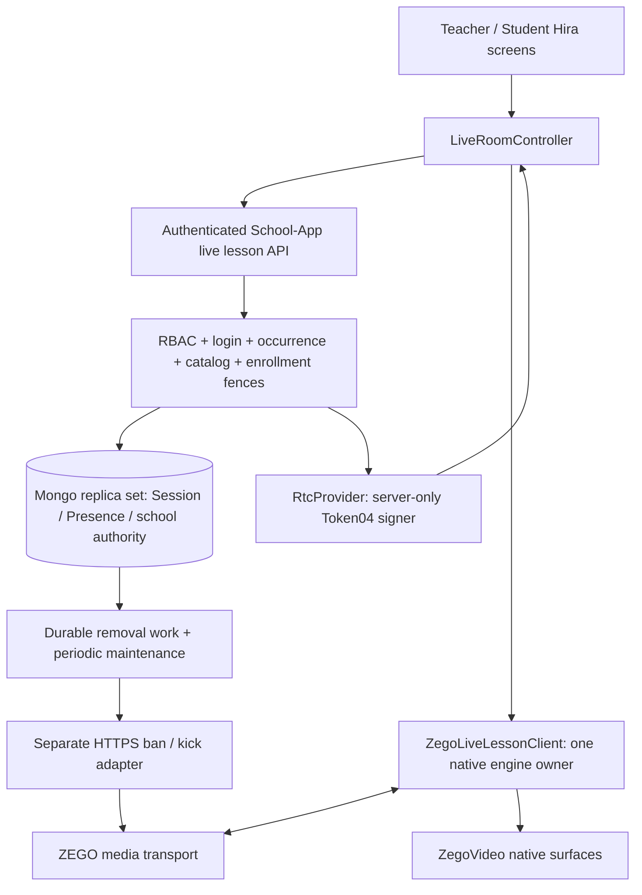

# T-PR15 final production hardening audit

Audit date: 2026-10-21. Branch: `feture`.

Reviewed foundations:

- A: `e153078e4f02a7608f70bae20bfc4210a63d3669`.
- B: `aabfec2f60ba4c4a94dae07a47a0ecc37e2ba432`.
- C / unchanged HEAD: `df7ef500a0e9a80359cdfab06d6bc1690add9bcc`.

Audit only. No application code, dependency, native configuration, existing report,
or initially dirty file changed. No staging, commit, push, recording or storage work.
Evidence and disposable probes are in `.validation-tpr15-final/`; exclude them from
feature commits. The probes assert observed failure behavior, not corrected behavior.

Evidence labels: **verified** means code inspection or local execution;
**inference** means a consequence of that evidence; **unverified** means an account,
production, or device observation is still needed. A passing mocked test is never
evidence of real provider eviction, media quality, mobile stability, or an achieved SLO.

## A. Executive verdict

**T-PR15 BLOCKED — token expiry does not guarantee termination of revoked media access.**

The school authorization architecture is sound and should be preserved. The audit
found a security assumption that must be resolved before further feature work: the
backend abandons enforcement at credential expiry, although ZEGO documents that its
default React Native token-expiry behavior preserves established media. A removed
modified client can ignore local shutdown. Failed provider eviction can therefore
leave continuing access without a bounded termination guarantee. This is **F01**.
The account's actual expiry mode was not inspected; this is not a claim that a live
account was exploited. The code accepts the documented unsafe default without
requiring evidence of the stronger mode.

Independent probes also reproduced worker poisoning, stale presence, controller/RTC
state divergence, duplicate recovery requests, and a low-selectivity maintenance
scan. They justify targeted hardening, not a rewrite of A/B/C.

Product authority: the supplied 73-page `Hira_School_App_Features.pdf`, located at
`C:/Users/Laptop Valley/OneDrive/Documents/Hira_School_App_Features.pdf`. Extracted
all pages and visually checked pages 22 and 37. Also reviewed pages 23, 27, 38, 39
and 68 for recording, attendance, publication and consent boundaries. The PDF defines
behavior; the audit prompt defines implementation quality. The PDF is not expected
to specify leases, SLOs, workers or rollout infrastructure.

## B. Current architecture map

The network control adapter is separate from the pure credential signer. Mongo
transactions never call provider network APIs. Provider callbacks are absent.

## C. Control-plane ownership

| Concern | Current owner and evidence |
| --- | --- |
| Identity / RBAC | School-App JWT plus current User and persisted login Session; client-supplied actor/role is not authority. |
| Occurrence / lifecycle / host | LiveLessonSession pins timetable occurrence, Branch, academic period, class/section/subject and actual host. |
| Admission / moderation | School-App transactions and LiveLessonPresence; current immutable host only. |
| Presence | Authenticated client-reported operational hint in Mongo, not provider-attested viewing. |
| Token issuance / renewal | Backend signer after current login, occurrence, assignment/substitute and enrollment checks. |
| Provider eviction | Backend durable intent; ZEGO performs ban/kick; completion is separately reported. F01 exposes an expiry assumption here. |
| Media connection / reconnect | ZEGO SDK transports; controller revalidates school authority. SDK recovery grants no school rights. |
| Rendering | React Native screens and native video surfaces; no academic decisions. |
| Historical metadata | Mongo immutable occurrence references and scoped historical reads. |
| Attendance | Separate school Attendance workflows; no live presence writes. |

**N01 — NO ACTION — CURRENT DESIGN IS SOUND:** retain this ownership. No inspected
provider event or client report can self-admit a learner or grant a new school
credential. F01 concerns continuing previously issued media access, not a new
backend enrollment grant.

## D. Session state audit

The schema enumerates `scheduled`, `starting`, `live`, `ended`, `cancelled`, `failed`.
The implemented start path creates/advances scheduled → starting → live within one
transaction; `live` means school start authorization, not proof of successful media.
Explicit End and host authority loss end the same durable occurrence. Failed signing
rolls back start; concurrent starts converge through unique period/date and room
indexes and transaction retries. End is idempotent. Terminal occurrences are not
silently restarted. Historical reads retain their historical academic scope rather
than requiring current timetable assignment.

**N02 — NO ACTION — CURRENT DESIGN IS SOUND:** no demonstrated need for `lobby_open`
or `ending` now. Future asynchronous recording work needs its own operation state;
that alone does not justify changing the live-session state machine.

## E. Participant/presence state audit

Admission (`waiting/admitted/rejected/removed/left`) and reported transport
(`connected/disconnected/reconnecting`) are different fields. `recovered` is a
client reliability transition, not a second admission. One lesson/actor record has
bounded 100-event history, cumulative reconnect count, first/last timestamps,
lease ownership, hand state, and durable enforcement state. Tokens are not stored.

**N03 — NO ACTION — CURRENT DESIGN IS SOUND:** retain the single operational record
and separate fields. **F08** covers missing expiry reconciliation rather than a need
to split presence into a new service.

## F. Waiting-room audit

Verified explicit active StudentEnrollment before admission request and credential
issuance. Waiting returns metadata only. Direct join-token requires admitted
presence; Students cannot admit themselves. Rejected/removed states are terminal
for this lesson. Waiting clients allocate no engine, preview, capture or media
credential. No listening room is hidden behind waiting UI.

Automated coverage includes admit/reject, admit/End, enrollment withdrawal,
idempotent admit, foreign/admin/self moderation and substitute replacement races.
**N04 — NO ACTION — CURRENT DESIGN IS SOUND.**

## G. Host/substitute ownership

An approved exact-occurrence substitute who starts becomes the immutable host.
Original Teacher moderation is denied. Later authority replacement fails closed;
maintenance ends the old occurrence instead of promoting another host. The existing
owner's End remains a safe teardown action. Two simultaneous moderators are not
created by a process-local lock.

Operational classification: **HARDENING RECOMMENDED BEFORE PILOT** (**F08**). Same
actor process restart loses the ephemeral connection key and can be blocked until
the old credential expires plus five seconds: normally about five minutes, up to
ten minutes. A battery failure can interrupt an entire lesson. First design explicit,
audited same-actor recovery with old-generation eviction. **F17** treats arbitrary
same-occurrence transfer as optional future policy; do not replace immutable
ownership with silent newest-device wins.

## H. Duplicate-device policy

Same screen/key and same authenticated login can retry and renew. A different key
or login waits out the persisted lease. Waiting leases renew for 30 seconds;
issued leases extend through credential expiry plus five seconds. Explicit Leave
does not prematurely release a still-valid provider credential. Deliberate Leave
requires fresh admission on return; stale takeover without Leave preserves logical
identity. Unique actor/lesson and shared Mongo fencing survive Node A/B/C.

**N05 — NO ACTION — CURRENT DESIGN IS SOUND** for duplicate authority prevention.
**F08** is the recovery usability gap. A new authenticated login alone must not
silently steal a room; any recovery policy must account for F01's media lifetime.

## I. Token security

Verified server-only Token04 generation, random IV/nonce, 30–600 second configured
TTL (default 300), scheduled-end cap, exact room/user binding, per-actor credential,
host publish=1 and Student publish=0. Only public AppID reaches the app. No AppSign
or provider server secret is passed to engine construction. Renewal reuses start /
join-token authorization and cannot switch provider, AppID, room, user or role.
Removal, End, enrollment/login/assignment/substitute revocation deny new issuance.
Concurrent changes are fenced in Mongo, not trusted frontend controls.

**N06 — NO ACTION — CURRENT DESIGN IS SOUND** for issuance and credential handling.
**F01 is the exception for termination of established media.** Do not lengthen TTL
or treat denied renewal as proof that a malicious client's existing stream stopped.

## J. Provider identity/privacy

Room and user identifiers use server-secret HMAC-SHA256, truncated to 160 bits,
scoped to durable session and actor IDs. They contain no school name, email, phone
or admission number and avoid stable provider IDs across lessons. Collision or
prediction is not a demonstrated risk at this scale. Room secrecy is not the
authorization mechanism.

**N07 — NO ACTION — CURRENT DESIGN IS SOUND.** Do not replace HMAC with plain hashes.
**F18** requires a coordinated secret-rotation runbook because identities depend on
the secret; rotating it during an active room changes derived user identities.

## K. React Native engine ownership

`ZegoLiveLessonClient` owns the module-level native engine lease. Screens construct
an adapter/controller, not native engines; memoized controller lifetime follows
target/login. The adapter serializes prepare/login/publish/renew operations and
guards duplicate connection/publishing. Late backend responses check controller
closure. Disposal closes new queued work, clears callbacks/timers, removes provider
listeners, independently attempts mute/camera off/publish stop/playback stop/preview
stop/logout/destroy, clears surfaces through unmount and is idempotent.

**N08 — NO ACTION — CURRENT DESIGN IS SOUND** for normal and rejecting-promise
cleanup. **F03** is an observed owner-state propagation defect. Native promises that
never settle can hold the serialized teardown queue indefinitely; this is a device /
fault-injection gate under **F10**, not a claimed observed orphan microphone.

## L. App/process lifecycle

AppState backgrounding closes owned waiting/media sessions. Unmount removes its
listener and closes ownership. Foreground requires school reauthorization and
explicit reopening; no automatic recapture or republish. Student capture remains
absent. No background service should be added for an unspecified product need.

Process death cannot send Leave: token/lease and persistent authority still prevent
new unauthorized issuance, but **F01** and **F08** prevent claiming complete recovery.
The process-death probe advanced beyond token/lease expiry: admission remained
`admitted`, hand stayed raised, and `leftAt` remained null. The host DTO reports stale
transport as disconnected after 30 seconds, which is useful but not reconciliation.

Audio routing/focus/interruption is principally SDK/platform responsibility; the app
must show normalized failures and close/reopen safely. Calls, Bluetooth/wired route
changes, other apps taking the mic, Activity recreation, Settings revocation and
vendor behavior remain **F10** physical gates. Do not add custom audio routing
without a reproduced platform defect.

## M. Reconnect architecture

Recovery reuses engine, occurrence, actor and provider identity. Backend classroom
verification and authorized renewal precede application recovery; a 30-second SDK
recovery deadline, five-second request gate and closure checks bound normal retries.
Polls are serialized and stop after three verification failures. End/removal/current
authority denial wins; local SDK transport recovery is not permission.

**F03 — P1 — REQUIRED BEFORE PRODUCTION PILOT:** terminal adapter errors/disposal
are not propagated to controller ownership except `removed`. The probe delivered
`connection='disconnected'` after successful enter; controller reliability stayed
`connected`, `closed=false`, and its next heartbeat reported `connected`. Native
device exception, reconnect failure and deadline can take this path. Correct the
terminal-state contract, stop owned timers, report truthful transport, and test all
terminal reasons while preserving backend session status independently.

**F04 — P1 — REQUIRED BEFORE PRODUCTION PILOT:** recovery lacks complete duplicate /
generation handling. Three same-turn `recovered` events issued four classroom calls;
the final connected report sits outside the five-second gate. A transient API/network
failure is collapsed into authorization loss and immediate closure, despite a
30-second media recovery budget. Coalesce the whole recovery operation, fence stale
event generations and distinguish transient timeout from definitive denial. Keep
retries within credential expiry/deadline; never allow offline authority extension.
Test simultaneous renewal/reconnect, delayed old expiry signals, duplicate recovery,
reordered reconnect/recovered, End and removal. Do not create another school session.

## N. Error taxonomy

Current frontend `RtcFailure.kind` covers expired/login/initialization; HTTP mapping
and safe SDK strings cover more display cases. Raw SDK enum interpretation stays in
the adapter, which is correct, but network/authority/provider/device failure is not
consistently distinguishable for recovery and metrics (**F04**, **F06**).

Use a small normalized result taxonomy with `PERMISSION_DENIED`, `TOKEN_EXPIRED`,
`NETWORK_LOST`, `UNAUTHORIZED`, `KICKED`, `SESSION_ENDED`, `ADMISSION_REJECTED`,
`PROVIDER_UNAVAILABLE`, `MEDIA_DEVICE_ERROR`, `ROOM_CAPACITY`,
`UNKNOWN_PROVIDER_ERROR`. Preserve retryability and generation alongside category.
Allowlisted numeric provider codes may be internal telemetry details, never raw
responses/URLs or business branching outside the adapter. Do not expose secret-bearing
exceptions to users in order to diagnose failures.

## O. Provider enforcement

Backend denial commits before ban/kick; failed provider calls cannot restore school
rights. Jobs are persisted on presence, atomically claimed for 15 seconds, retried
after crashes and protected by revision/attempt checks against stale completion.
Ban failure still attempts kick. Calls use fixed HTTPS origin, no redirects and
five-second deadlines per request. `confirmed` requires both operations succeeding;
it is API acknowledgement, not independent proof of watching cessation.

**F01 — P0 — SECURITY / DATA-INTEGRITY BLOCKER.** At
`backend/src/services/live-lesson.service.ts:590`, `enforceRemoval` treats expired
credentials as expired work without a provider call; the adapter also refuses
post-expiry kick. The production signer only requires room-privilege acknowledgement,
not an expiry-disconnection mode. The isolated probe confirmed removed presence
became `enforcement='expired'` without provider confirmation.

ZEGO's native/RN documentation says established users/media continue under default
expiry behavior; support can configure a mode that disconnects users and stops
publishing. A login ban also does not itself eject an existing user. Therefore a
removed modified client, or revoked host, that ignores app shutdown can retain media
when kick fails or jobs miss expiry. No finite revocation bound follows from current
TTL alone. Account configuration is unknown, not verified unsafe or verified safe.
[React Native token expiry](https://www.zegocloud.com/docs/live-streaming-rn/communication/use-token-authentication),
[ban semantics](https://www.zegocloud.com/docs/live-streaming-server/api-reference/room/forbid-user-rule/set-forbid-user-rule).

Required closure: establish an enforceable provider termination bound. The narrow
option is verified project-level hard-expiry eviction, an explicit fail-closed
deployment prerequisite, and real modified-client tests of playback/publishing after
removal/End with kick unavailable. Otherwise redesign enforcement lifetime and
generation identity so retries can safely continue after token expiry without
kicking a newly authorized generation. Do not simply remove the current post-expiry
guard: it protects legitimate later connections with the same provider ID. Correct
the earlier reports' expiry-fallback claim after evidence exists. No safe isolated
code-only repair can establish the account setting during this audit.

**F02 — P1 — REQUIRED BEFORE PRODUCTION PILOT.**
`live-lesson.service.ts:661` cleans up revoked authority through
`withAcademicCatalogLock`, whose Branch lock requires `isActive=true`. The probe
deactivated a Branch: maintenance rejected 404 and a due enforcement job had zero
attempts. Cleanup must work after deactivation. Isolate each identity's cleanup
failure, preserve revision fencing with a cleanup-safe transaction, and drain
enforcement independently. Test one invalid Branch alongside another Branch's due
job. An inactive host remains eligible for repeated scans, amplifying the failure.

## P. Provider callback recommendation

Conceptual recommendation: **RECOMMENDED BEFORE PILOT**, especially for diagnosing
F01; **F14 — P2 — REQUIRED BEFORE FULL ROLLOUT** for scalable transport reconciliation.
A tightly controlled pilot may use verified hard expiry, bounded reconciliation and
operator verification without a new callback surface. Callbacks improve evidence
of logins, logouts and streams; they cannot become school authority or perfectly
reliable attendance. ZEGO itself warns callbacks are not completely reliable.
[Callback reliability](https://docs.zegocloud.com/article/9804/).

Any future ingestion must verify the exact product's signature using raw canonical
inputs, require a timestamp window, use event-ID deduplication or a deterministic
event fingerprint when no ID exists, map room/session server-side, enforce replay
protection and idempotency, reject malformed/foreign events, and store only sanitized
minimal metadata. Reordered callbacks cannot undo removal or End. Do not invent an
unauthenticated endpoint now.

## Q. Presence reconciliation

**F08 — P1 — REQUIRED BEFORE PRODUCTION PILOT** covers process death and same-actor
recovery. Combine expired lease/credential, heartbeat age, session terminal state
and current authority; clear stale raised hands and represent stale ownership
explicitly without converting hints into attendance. Do not silently re-admit an
explicitly left/removed/rejected actor. Preserve admission policy where a disconnected
admitted learner may legitimately return. Same-actor reclaim needs explicit old-media
termination, not just resetting a correlation key. Define a host-loss policy and
explain recovery to users rather than leaving a multi-minute unexplained conflict.

F14 later adds verified provider signals and periodic reconciliation. No single
heartbeat, expiry, callback or connected flag proves the learner watched a lesson.

## R. Presence vs Attendance

Live service/state/RTC code has no Attendance mutation or joined→present coupling.
Existing attendance services remain separate. The PDF pages 27/38/39 explicitly
keep absence and learning completion separate from video opening/watching.
**N09 — NO ACTION — CURRENT DESIGN IS SOUND.** Keep this invariant for future analytics.

## S. Secret/logging privacy

Scanned 420 tracked text/code/config files plus 42 B/C manifest files and 72 B/C/audit
validation logs for literal JWTs, Token04 values, secret assignments, private keys and
signed provider URLs. Only two server-secret assignment matches were synthetic
provider test fixtures; no literal JWT/Token04/private-key leak was found in the
scanned scope. Only `backend/.env.example` is tracked; provider values are blank,
JWT/bootstrap examples are placeholders. This is a scoped scan, not a certification
of all Git history or external crash/reporting infrastructure.

Credentials remain call-frame/memory data, absent from AsyncStorage, navigation,
presence, analytics and application logs. Server moderation logs contain operation,
session ID, role, time and latency. Host roster DTOs carry authorized school display
names and operational IDs; Student DTOs expose own presence only. Names/IDs are not
automatically safe telemetry dimensions: apply retention/access controls and avoid
high-cardinality labels. No classroom content is logged by this feature.

The SDK receives `logConfig` with zero size and empty path; application intent is
clear, but SDK/native crash log contents must be checked on real devices (**F10**).
**N10 — NO ACTION — CURRENT DESIGN IS SOUND** for inspected application sinks.

**F09 — P1 — REQUIRED BEFORE PRODUCTION PILOT:** shared `apiClient.ts:1` hardcodes
a private-LAN HTTP URL, including in the closed baseline; the pre-existing dirty
patch only changes its IP. Live credentials and bearer headers use that client.
Debug Android permits cleartext; installed RN release configuration disables it.
Thus debug use can expose credentials on an untrusted LAN and the current release
URL can fail closed rather than connect. Provide build/environment-specific HTTPS
API configuration and verify release traffic without weakening cleartext policy.
This is a shared deployment gate, not a new T-PR15 authorization bug. The already
dirty API file was preserved exactly; no opportunistic edit was made.

## T. Observability

Current structured hooks cover moderation latency, aggregate enforcement work and
generic maintenance unavailability; presence stores timestamps/counts. They cannot
currently calculate client media join success, reconnect duration or end cleanup
failure rates. Provider failure reasons collapse to one sanitized category, hiding
quota versus entitlement versus transport failures from operators.

**F06 — P1 — REQUIRED BEFORE PRODUCTION PILOT:** add a small allowlisted event/metric
contract for join attempt → backend credential → room connected → host publishing /
Student first playback; token fetch/renewal outcome; admission latency; unexpected
disconnect; reconnect duration/result; quality degradation; camera-off fallback;
removal confirmation; cleanup outcome; worker duration/last-success/backlog age and
quota failures. Use an attempt correlation ID, role/platform/app version and bounded
failure category; no token, URL, name, chat, provider secret or classroom content.
Define operator alerts/runbooks and a pilot dashboard before claiming SLOs.

## U. Production SLO targets

**PILOT PRODUCTION SLO TARGETS — proposed, not achieved.** Observe rolling seven-day
windows, segment platform/version/Branch without exposing user identity, and publish
sample counts. Below 100 eligible attempts, treat percentages as descriptive rather
than statistically stable. Security revocation failures are incidents even at low N.

| Indicator | Initial target and denominator |
| --- | --- |
| Join success | ≥98% of eligible, admitted, user-initiated attempts reach RTC connected within 15 seconds; host publishing / Student first playback measured separately. |
| Join latency | p95 <4 seconds from authorized join intent to connected; admission waiting and human moderation delay measured separately. |
| Renewal failure | <0.5% of required renewal attempts fail while authority remains valid; denials still counted in security/category dashboards. |
| Unexpected disconnect | <3% of connected visits end unexpectedly; exclude explicit Leave/End/background by separate reason, never drop them from raw telemetry. |
| Recovery | Initially p95 <10 seconds and ≥95% of recoverable network events within the 30-second budget and valid credential window. |
| Revocation | A verified, documented finite media termination bound, including failed kick and modified clients; F01 blocks asserting one today. |
| Worker health | Alert on missed successful cycles >30 seconds or oldest due job >15 seconds during the small pilot; thresholds must be reconciled with measured capacity. |

Do not treat the test counts below as measurements of any of these indicators.

## V. Telemetry buffering recommendation

No offline telemetry queue exists. **F19 — P3 — SAFE DEFERRED HARDENING:** start with
a bounded in-memory buffer and online batch upload for F06. If persistent offline
events are needed, cap at 100 events / 64 KiB and 24-hour TTL, redact before enqueue,
drop oldest, jitter bounded retries, deduplicate by event ID, and clear on logout /
account switch. Never store bearer/RTC credentials or content. Avoid a new durable
telemetry subsystem without an observed offline diagnostic need.

## W. Feature flag / kill switch

`LIVE_LESSON_ENABLED` is server environment configuration, checked by the signer;
there is no runtime operator switch or per-Branch rollout gate. Changing deployment
environment is not the required reversible-without-deploy control, and disabling
issuance alone does not terminate existing media.

Classification: **REQUIRED BEFORE PILOT**.

**F05 — P1 — REQUIRED BEFORE PRODUCTION PILOT:** introduce
simple server-authoritative runtime `globalLiveEnabled && branchLiveEnabled`
configuration, current-auth operator access and an audit trail. Enforce discovery /
admission/start/issuance consistently. Define two operations: stop new sessions and
drain existing ones, versus urgent closure with durable eviction. Existing End and
cleanup must remain available when disabled. Test multi-instance propagation and
rollback with F01's actual media bound. No generic flag platform is required.

## X. Rate limits

Persisted issuance allowance is 10/minute per actor/lesson, shared by backend
instances. Meaningful admission/hand/moderation transitions have a 500 ms per-target
cooldown; replayed no-ops do not add history. These are useful correctness controls.
They do not bound all authenticated classroom polls, repeated admission/no-op
requests, roster reads, or provider calls across one AppID. A modified client can
drive expensive transactions even when issuance is denied later.

**F07 — P1 — REQUIRED BEFORE PRODUCTION PILOT:** configure endpoint budgets by
authenticated actor/session plus room/Branch and a provider-wide AppID enforcement
budget, shared across instances. Preserve ordinary five-second polling and tolerate
short retry bursts. Return bounded retry guidance; never rely solely on campus NAT
IP limits. Expose cooldown/issuance/poll/capacity constants as validated deployment
configuration only where pilot measurement needs adjustment. Keep school authority
checks on every actual privilege mutation. Provider cost/entitlement checks are AK.

## Y. Participant capacity

500 counts distinct actor records including host, not just simultaneously connected
users. Capacity is checked inside the serialized lesson transaction; deterministic
409 and roster completeness are tested. Host exists before admission can consume
capacity. Terminal and stale rows retain identity/history and continue to count.
This conservative cap must not be described as a tested 500-device media capacity.

**F13 — P2 — REQUIRED BEFORE FULL ROLLOUT:** retain an upper bound of 500, make a
lower pilot cap explicit, and load-test provider and low-end host roster rendering.
The full roster maps to nonvirtualized cards and does repeated name lookups; virtualize
or page safely if profiling warrants it, with an accurate total and accessible
moderation. Do not increase the cap. A 2–15 participant pilot still needs F07/F10 and
account gates. F08 addresses stale hand/lease state rather than deleting audit rows
to recycle capacity silently.

## Z. Mongo indexes/explain

Unique occurrence, unique provider room and unique presence actor/lesson indexes
are installed before traffic even with autoIndex disabled. Roster prefix, admission,
enforcement/due-time, active-maintenance, and scoped session indexes exist. No
speculative index removal is justified by their small schema overlap alone.

Executed `explain('executionStats')` against isolated MongoDB 8.2.6 with 5,000
synthetic presence rows: 100 active plus 4,900 expired but still admitted rows.

| Query | Returned | Keys / documents examined | Plan |
| --- | ---: | ---: | --- |
| Exact lesson/actor | 1 | 1 / 1 | unique_classroom_actor IXSCAN |
| Lesson roster | 100 | 100 / 100 | unique_classroom_actor prefix IXSCAN |
| Due enforcement | 20 | 21 / 20 | enforcement + enforcementAfter IXSCAN |
| Active maintenance, checkedAt order | 100 | 5,000 / 5,000 | active_classroom_maintenance IXSCAN + residual eligibility filter |

No COLLSCAN or blocking SORT occurred for these four query shapes. This does not
certify production query plans, discovery/history queries, distribution or cache
behavior. The existing session index matches the leading discovery scope; capture
production-like `explain` for final cardinality/sort distribution before broad rollout.

**F12 — P2 — REQUIRED BEFORE FULL ROLLOUT:** expired admitted history remains in
the ordered maintenance index but fails the role/credential residual filter.
Reconcile eligibility and benchmark an eligibility/next-check query/index design;
do not merely add indexes to every field. Measure write amplification and bounded
scan cost after the change. Evidence: `.validation-tpr15-final/explain.json`.

## AA. Transactions/fences

Admission, issuance, moderation, enrollment/catalog/timetable/substitute changes and
End share persisted writer fences, snapshot transactions and majority commits.
Teacher/user/login and exact academic entities are reloaded. Provider signing is
pure local work; external ban/kick is post-commit. Unique indexes and transaction
retry protect cross-process identity, not in-memory state. Existing concurrency
regressions passed, including stale maintenance and stale enforcement generation.

**N11 — NO ACTION — CURRENT DESIGN IS SOUND** for privilege-changing transactions.
Their current use for every heartbeat is a separate performance concern (**F11**).

**F11 — P2 — REQUIRED BEFORE FULL ROLLOUT:** five-second classroom polling enters
the entire `mutateOccurrence` authority/fence path. Even passive Student heartbeats
write shared host/Branch/catalog/occurrence fences, serializing unrelated peers and
lessons within a Branch. A ten-Student simultaneous heartbeat probe completed all
ten but took 3,430 ms overall (p50 1,784 ms, p95 3,428 ms), with 130 User updateOne
attempts and ten each across Branch, timetable period/version, class, section,
subject, assignment, login Session, academic period, ClassSubject, lesson, Student,
enrollment and presence. The complete counts are in the probe log.

These are local Windows synthetic numbers, not production throughput or an SLO
failure claim. They demonstrate real contention/amplification and justify measuring
the proposed 10–15 participant pilot on deployment hardware before enabling it.
Optimize the read/heartbeat path narrowly with explicit authority-version semantics;
retain strict fences on token/admission/moderation/End. Do not remove security locks
as an unmeasured performance shortcut or add Redis by reflex.

## AB. Maintenance-worker scale

Each process ticks every ten seconds with a local busy guard. A pass checks at most
100 active identities, then serially processes up to 50 removal jobs. Identity checks
reuse full authority transactions. Claims are durable; the busy flag is an efficiency
guard. Fast nominal rate is at most ten checked identities/second/process before DB
and network overhead. Adding replicas does not guarantee linear capacity because
selection/checking can overlap and all share Mongo/provider quotas.

Assuming 30 Students + one host per lesson, scheduled polling demand and ideal
single-worker revalidation sweep are:

| Simultaneous lessons | Actors | Poll requests/sec at 5 sec | Ideal sweep at 100 per 10 sec |
| ---: | ---: | ---: | ---: |
| 10 | 310 | 62 | about 40 sec |
| 100 | 3,100 | 620 | about 310 sec |
| 1,000 | 31,000 | 6,200 | about 3,100 sec / 52 min |

These are optimistic arithmetic bounds, not measured service guarantees. At the
500-actor cap the poll rates become 1,000 / 10,000 / 100,000 req/sec respectively.
Fences, retries, F02 and F12 worsen the estimates. Fifty jobs with two sequential
five-second timeouts can occupy a pass for about 500 seconds before DB overhead,
preventing that process's next authority scan. This can exceed token lifetime.

F02/F06/F07 are pilot requirements. F12 also requires bounded/fair work scheduling,
separate authority checking from slow enforcement, and active-check coordination at
full scale. Mongo claims can remain the work queue initially. A dedicated worker
deployment is reasonable after measured contention; Redis/Kafka is not established
as necessary. Track due-job age and revocation latency rather than just jobs/pass.

## AC. Multi-instance correctness

No school permission or logical participant uniqueness depends on local Set/Map.
Mongo locks, unique indexes, persisted leases and job claims survive process death.
Separate Node process tests cover competing hosts/Students, substitute/moderation,
reconnect/End and expired job claims. Local SDK ownership is necessarily per mobile
process; backend lease handles other processes/devices. **N12 — NO ACTION — CURRENT
DESIGN IS SOUND** for authority. Provider-wide rate limits and maintenance scheduling
remain F07/F12; a process-local busy flag cannot solve either.

## AD. Duplicate/out-of-order event safety

| Event/race | Current result / gap |
| --- | --- |
| Admit twice / reject twice / remove twice | Idempotent logical transition/history; repeated confirmed removal does not duplicate provider work. |
| Admit vs End / withdrawal / reject | Shared transaction fences choose one valid result; tests pass. |
| Rejoin vs remove / reconnect vs End | Removed/ended wins future credentials; process tests pass. |
| Late backend response after close | Controller closed guard prevents login/renew revival. |
| Old token warning after fresh renewal | Timer/renewAfter gate prevents renewal loops; expand alongside F04. |
| Stale maintenance snapshot after reclaim | Revision comparison prevents ending the freshly reclaimed host; tested. |
| Old provider completion after new generation | Revision + attempt CAS prevents stale confirmation; tested. |
| Slow ban crosses expiry | Adapter refuses late kick to protect later connection; tested, but depends on solving F01. |
| Student Leave after removal | Terminal removal preserved. |
| Repeated/reordered recovered notifications | Four requests for three repeated events observed; F04. |
| Terminal RTC callback | Controller can keep connected heartbeats; F03. |

## AE. Classroom chat gap

**CLASSROOM CHAT DEFERRED PRODUCT GAP — F15 — P2 — REQUIRED BEFORE FULL ROLLOUT.**
PDF page 22 requires Teacher classroom chat; page 37 requires Student chat/Ask.
C intentionally deferred it, and no classroom chat transport/history was implemented.
A/B/C can be described as a receive-only live-media foundation with admission and
moderation, not a complete Teacher Live Host product.

Recommend a **separate scoped PR before recording**, after the P0 and critical
hardening contract is resolved, because participation/questions are core live-class
behavior. This is a product sequencing recommendation, not a technical dependency
forcing a chat rewrite into T-PR15D. A limited pilot may explicitly exclude chat;
full PDF-scope completion may not. Decide retention, audience, moderation, enrollment
scope, no-transcript-default policy and reuse of existing messaging contracts before
choosing a transport. No chat code is added in this audit.

**F16 — P2 — REQUIRED BEFORE FULL ROLLOUT:** also track remaining PDF behavior:
screen/whiteboard/document-camera sharing, Student explicit audio-only receiving
controls and the future recording notice/consent experience. Teacher camera-off
fallback exists. Initial Teacher permission policy requires both mic and camera,
so camera-denied audio-only startup is not a complete PDF fallback. Generic PDF
Student mic/camera language must be reconciled with the explicitly approved current
receive-only policy, not implemented as automatic capture. Recording controls belong
to deferred phases. Lack of a remote Student mute button is correct with publish=0.

## AF. Hand-raise/publishing future policy

Current hand state is a school-scoped signal only; it neither grants publish
permission nor invokes capture. **N13 — NO ACTION — CURRENT DESIGN IS SOUND.**
Student raises hand → Teacher approval → temporary publishing would require a
separately authorized, expiring media role, consent/permissions, revocation and
provider privilege enforcement. It is future product work, not an implicit part of
acknowledging a hand. Do not weaken receive-only Student tokens now.

## AG. Android device matrix

**F10 — P1 — REQUIRED BEFORE PRODUCTION PILOT. PRE-RELEASE DEVICE VALIDATION REQUIRED.**
Run the matrix on physical Samsung, Xiaomi, Oppo or Vivo, and a low-end Android
device (record model, OS, RAM, app/SDK version and network). Use two-device Teacher /
Student sessions and repeat across these four device categories; cover the supported
Android version range and a real release build, not only debug/emulators.

| Group | Required cases and assertions |
| --- | --- |
| Permissions | First denial, permanent denial, Settings revocation during session; visible actionable fallback, no silent recapture; Student never prompted for capture. |
| Lifecycle | Background/foreground, screen lock, swipe away, OS process kill, low-memory kill, Activity recreation, reopen; no hidden capture, truthful stale state and documented lease recovery. |
| Interruptions | Incoming/active phone call, another app taking mic/camera, Bluetooth attach/detach, wired headset if supported, speaker/earpiece switch; routing/focus verified, no custom logic assumed necessary. |
| Networks | Wi-Fi→mobile, mobile→Wi-Fi, airplane mode, throttled 2G/3G, packet loss and total outage; same logical identity, bounded recovery, no false success or surprise republish. |
| Authority | Duplicate-device join, Teacher crash, substitute change, enrollment withdrawal, Student removal, End during recovery, login revocation; no unauthorized issuance and bounded media termination. |
| Token/provider | Expiry mid-class and scheduled end, denied renewal, unavailable kick/ban, modified client ignoring local close; verify F01 on configured account. |
| UI/accessibility | RTL, screen reader names/focus, disabled semantics, visible camera/mic/quality state, 44-point targets, roster usability and no color-only status. |

No physical scenario has been marked PASS by this audit. SDK defaults are not a
substitute for device verification of routing, capture release, or native logs.

## AH. Memory/resource gate

F10 includes a **hard pre-release gate of at least 20 join → media → Leave → fresh
admission/rejoin cycles** per representative role/device, including failed joins and
background close. Respect lease/terminal policies; do not disable them to speed up
testing. Use controlled occurrences where End is terminal.

Record JS heap, native PSS/RSS, video surfaces, engine ownership, listener counts,
timers and provider room users after warm-up and at each cycle. Require no sustained
monotonic retained growth, flat listener/timer counts, no duplicate callbacks,
released camera/mic indicators, no orphan playback/users and no zombie engine.
Include native calls that reject and deliberately never settle; investigate ownership
timeouts if the queue cannot drain. Save traces and plateau bounds for each device;
do not invent a universal memory limit or claim a mock proves resource stability.

## AI. Chaos test plan

| Scenario | Existing automation / remaining execution |
| --- | --- |
| Network killed during join | Late authorization/dispose guards mocked; actual native login hang/loss requires devices. |
| Network killed after connected | Mocked normalized reconnect/deadline; real transport + transient backend failure remains. |
| Same Student on two devices | Cross-process backend lease tests pass; physical provider duplicate identity still required. |
| Teacher crash | New process-death/stale-state probe confirms gap; actual restart/reclaim/capture test required. |
| Approved substitute changes | Cross-process current-authority and moderation fences tested; device termination bound required. |
| Enrollment revoked mid-class | Issuance/maintenance tests pass; modified-client continued playback must be tested. |
| Student removed during renewal | Transaction/renewal denial covered; provider timing and callback ordering integration required. |
| Token expires mid-class | Signer caps/renewal timers tested; account hard-expiry behavior unverified, F01. |
| Backend instance dies during moderation | Durable claim recovery tests pass; terminate instance after commit/before provider call in staging. |
| Provider unavailable | Mocked failure/sanitization pass; failure injection on staging account required. |
| Kick succeeds / ban fails | Independent calls/failed confirmation tested; verify real re-login denial/window. |
| Ban succeeds / kick fails | Independent calls/failed confirmation tested; continuing playback is F01's critical case. |
| End during reconnect | Backend cross-process End fence/controller close mocked; physical event ordering required. |
| Class-start storm | Ten synthetic heartbeats measured; larger start/renewal storm not executed. |
| Inactive Branch + foreign due jobs | Audit probe reproduces worker abort; regression for isolated cleanup required after fix. |

Mocks and local replica-set tests are listed as such; no paid provider chaos was run.

## AJ. Load-test plan

Phase 1: 2–5 participants, one lesson, account-approved staging environment. Establish
correctness, F01/F03 behavior and instrumented baseline. Phase 2: 10–15 participants,
one pilot Branch, synchronized start plus staggered renewals and one network switch.
Phase 3: multiple simultaneous lessons, increasing Branch concentration, then 10 /
100 / 1,000 lesson *synthetic control-plane* workloads before considering provider
media load at any comparable level. These are design steps, not authorized paid runs.

At each phase collect API p50/p95/p99, Mongo operation/transaction latency and retry
counts, write conflicts, issuance rate, worker cycle/backlog/oldest job, provider
quota failures, reconnect duration, mobile CPU/PSS/JS heap, battery/thermal impact,
audio/video quality and time to first playback/publish. Test worst-case simultaneous
renewals, whole-Branch End and two/three backend instances. Set abort thresholds for
authority violation, unbounded revocation, SLO regression, cost or thermal stress.
Benchmark production-like Mongo topology and latency; local numbers do not certify it.

No destructive production load, real provider media load or paid account calls were
made. Confirm AK and implement rollback controls before authorized staging load.

## AK. ZEGO capacity/cost gate

**F07 account gate:** inspect the configured project with its owner before pilot or
paid testing: room/publish privileges, hard-expiry eviction, concurrent users/rooms,
ban entitlement, rule capacity, server quotas, region, billing unit, participant-minute
and bandwidth/media usage costs, alerts and spending cap. Actual account values and
current negotiated pricing are **UNVERIFIED**; no price or entitlement is invented.
Recording capacity/cost is not included or exercised.

Public docs currently describe 10 ban requests/second per AppID and 200 concurrent
room/user rules, versus 50 kick requests/second. Multi-instance direct removal and
worker calls need a shared budget. A 500-person End cannot assume 500 concurrent
individual ban rules fit the documented default; verify entitlement or adopt a
bounded room-close strategy with safe generation semantics after design review.
[Ban quotas](https://www.zegocloud.com/docs/live-streaming-server/api-reference/room/forbid-user-rule/set-forbid-user-rule),
[kick quota](https://www.zegocloud.com/docs/live-streaming-server/api-reference/room/kick-out-user).

## AL. Rollout strategy

| Stage | Scope / promotion requirement |
| --- | --- |
| 0 | Internal test users only; resolve F01, verify account, HTTPS, instrumentation and physical safety gates. |
| 1 | One explicitly enabled pilot Branch, 2–15 participant approved cap; all P1 gates closed, staffed rollback owner. |
| 2 | Approximately 25% of eligible enabled Branches after measured SLOs, quota headroom and complete failure drill. |
| 3 | Broader rollout with F11–F14 scale/reconciliation evidence, device matrix and resolved product-scope decisions. |
| 4 | 100% only after P2 gates and full PDF-scope release signoff; retain global and Branch rollback. |

At every stage monitor join success/latency, renew failure, reconnect/unexpected
disconnect, enforcement delay/failure and provider errors. Require enough observed
eligible attempts and representative networks before promotion, not a calendar-only
deadline. Roll back Branch/global enablement without deploy; distinguish drain from
urgent closure and verify existing media ceases under F01's proven bound. Keep safe
End available. A kill switch that merely hides the button is insufficient.

## AM. Failure-mode table

Operator signals marked missing are requirements under F06, not existing metrics.

| Failure | User-visible behavior | Backend truth | Retry / operator signal |
| --- | --- | --- | --- |
| Backend unavailable | Safe request failure; polls close after three failures; reconnect currently closes immediately. | School row may still be live; no new authorized credential. | Bounded transient recovery needed F04; API errors/latency and poll closure metrics missing. |
| Provider unavailable | Media failure separate from school live state. | Authorized occurrence persists; do not create another. | Explicit school-authorized retry; provider failure categories/first-media metrics missing. |
| Token expired | Normal client renewal/close; modified client may retain media under default. | Future issuance rechecks authority; expired job not confirmation. | F01 blocks expiry fallback; refresh + termination telemetry required. |
| Enrollment revoked | Future join/renew denied, compliant client closes. | No enrollment authority; worker queues removal. | No privilege retry; revocation/media-bound alert missing. |
| Teacher authority revoked | Current APIs deny; maintenance ends immutable occurrence. | No silent replacement host. | Explicit recovery/product policy; worker correctness F02. |
| Provider kick fails | Host sees pending confirmation / failed work, never instantaneous success. | Removed remains terminal. | Durable retry until expiry today; F01 required; due-age/failure alerts missing. |
| Network lost | Quality/reconnect message or terminal failure. | Last client hint may be stale, not attendance. | Same identity bounded recovery; F03/F04; duration/disconnect metrics missing. |
| Camera unavailable | Sanitized device error; preview/start restrictions; camera-off control if already active. | School session independent from publishing. | Explicit fallback/reopen, F16 startup gap; device category metric missing. |
| Microphone unavailable | Permission guidance or sanitized device error; no hidden capture. | School start not proof of successful audio. | Settings/explicit reopen; F10; media-device metric missing. |
| Session ended | Closed lesson and no further credential. | Terminal occurrence, presence closure and durable removal intent. | No same-occurrence restart; provider termination verification F01. |
| Duplicate connection | 409 conflict; no automatic takeover. | Existing lease retained. | Wait token expiry+grace; explain recovery F08; conflict metric missing. |
| Maintenance delayed | Roster may look stale; compliant clients still revalidate. | Outstanding authority checks / eviction intent. | Durable claims survive crash; F02/F12; oldest job/last-success missing. |

## AN. Recording-readiness assessment

Stable school session ID, immutable occurrence, authorized host, opaque provider room,
scoped backend APIs and End make a sound attachment point. The provider interface
has a normalized event shape, but no verified event ingestion, recording control,
recording job state or callback replay handling exists yet. Reserved types are not
an implemented recording boundary.

F01/F02 must be resolved before relying on End as a media termination boundary.
Before D implementation, agree that explicit End, host revocation, schedule expiry
and urgent operator closure each produce one idempotent post-commit lifecycle intent
for future recording stop/finalization. A recording operation must not make database
transaction retries call provider APIs or equate school `live` with recording/publish
success. Use separate recording state and consent/publication authorization. No core
A/B/C rewrite is currently justified; no recording code/model/webhook/task is added.

## AO. R2/storage-readiness assessment

Future flow can remain provider output → private object storage → RecordingAsset
metadata referencing LiveLessonSession → School-App authorization → short signed
playback. Mongo stores metadata, never binary video. PDF pages 23/38 require review /
publication and enrolled learner access; page 68 requires versioned purpose-specific
consent and revoked future permission handling. Keep recording consent, retention,
publication and playback permissions distinct from current room admission. Do not
expose a public bucket or persistent provider URL to solve access. This is an
architecture assessment only: no R2, Cloudinary, storage or recording implementation.

## AP. Security attack review

| Attack | Evidence / result |
| --- | --- |
| Branch/class/section escape | Exact immutable scope + current catalog/enrollment fences; tests deny before signing. |
| Forged participant ID / foreign moderation | Host/session/target lookup scoped; another lesson's target cannot be moderated. |
| Student self-admit / forge host role | JWT, persisted login/current role and host ownership checked; UI is not trusted. |
| Original Teacher moderates substitute room | Actual immutable host + occurrence/substitute fences deny. |
| Replay start/join | Same actor/key converges; rate-limited issuance and current authority rechecked. A valid bearer is replayable within its grant; it is not a one-use ticket. |
| Stale renewal after remove/End/withdrawal | Fenced backend denial; no future school credential. |
| Token used in another room/user | Token04 payload room/user binding; decrypted claim tests pass. Real privilege configuration remains an account prerequisite. |
| Direct provider login without school issuance | No secret / client signer; attacker cannot mint a credential. Leaked valid tokens remain bearer capabilities until provider enforcement. |
| Changed connectionId / second device | Persisted lease denies active takeover; no multiplied actor rows. |
| Modified client ignores removal/expiry | **F01 P0**, continuing access under documented default after failed kick. |
| Callback spoofing | No callback endpoint now; future signature/replay rules in P apply. |
| Log exfiltration | Scoped source/log scan found no real credential value; external/native sinks unverified. |
| Request flood / rate bypass | Issuance allowance holds, but passive/no-op work remains floodable; F07. |
| LAN interception | Shared HTTP debug endpoint exposure/release connectivity gate; F09. |

No successful new-school-authority bypass was reproduced. F01 is a continuing-media
privacy/security blocker despite correct backend denials. No real user, project
secret or production room was used in attack probes.

## AQ. Modified-client abuse review

Direct join-token before admission, skipped waiting UI, moderation by Student,
forged host identity, another Student's actor ID, room substitution and active lease
stealing fail server checks. Changing a client label cannot change role, publish
grant or provider identity. Repeated authorized renewals share the 10/min persisted
allowance; rapidly repeated classroom/no-op requests still need F07 protection.

An admitted modified client can lie about connected/hand state; the backend explicitly
models these as operational hints, not attendance. Most critically it can keep an
already-established provider connection after backend revocation if provider kick
fails and default expiry does not disconnect it (F01). Frontend close, muted controls,
timers or refusal to renew do not secure that adversary.

## AR. Things NOT to add yet

Do not add Redis, Kafka, a generic event bus, microservice split, Kubernetes-specific
correctness assumptions, custom TURN/STUN, a second chat platform, a WebSocket layer
without measured polling need, a generic flag service, background broadcasting,
forced Student mute for a receive-only role, automatic attendance, longer tokens,
newest-device takeover, recording/R2 pipelines or speculative lifecycle states.
Preserve Hira UI, provider abstraction, exact occurrence/enrollment fences, durable
Mongo authority and independent cleanup attempts. Small targeted corrections and
measured deployment controls come first.

## AS. P0 findings

| ID | Exact classification | Required closure |
| --- | --- | --- |
| F01 | P0 — SECURITY / DATA-INTEGRITY BLOCKER | Establish verified finite provider media termination after removal/End despite modified clients and failed kick; fail closed on missing account prerequisite or implement safe generation-aware enforcement lifetime. Expiry alone is not sufficient. |

No P0 code change was attempted: neither account configuration nor a safe replacement
for the generation/lease contract can be established by a narrow local edit. Keep
further feature implementation paused until the security invariant is closed.

## AT. P1 findings

| ID | Exact classification | Required pilot closure |
| --- | --- | --- |
| F02 | P1 — REQUIRED BEFORE PRODUCTION PILOT | Cleanup after inactive Branch; per-row failure isolation; independent due-job draining. |
| F03 | P1 — REQUIRED BEFORE PRODUCTION PILOT | Terminal RTC state closes controller ownership/timers and sends truthful transport. |
| F04 | P1 — REQUIRED BEFORE PRODUCTION PILOT | Whole-operation recovery coalescing/generation guards and transient-vs-denial taxonomy. |
| F05 | P1 — REQUIRED BEFORE PRODUCTION PILOT | Runtime global/Branch enablement, safe drain/urgent closure and tested rollback. |
| F06 | P1 — REQUIRED BEFORE PRODUCTION PILOT | Minimal private metrics, dashboard, alerting and failure runbooks. |
| F07 | P1 — REQUIRED BEFORE PRODUCTION PILOT | Actor/room/Branch and provider-wide request budgets; verified account entitlements/cost/capacity. |
| F08 | P1 — REQUIRED BEFORE PRODUCTION PILOT | Process-death reconciliation and explicit safe same-actor recovery policy. |
| F09 | P1 — REQUIRED BEFORE PRODUCTION PILOT | Shared release HTTPS API configuration and real release connection verification. |
| F10 | P1 — REQUIRED BEFORE PRODUCTION PILOT | Physical safety/network/permissions/termination and 20+ cycle resource gates; iOS before an iOS pilot. |

## AU. P2 findings

| ID | Exact classification | Required broad-rollout closure |
| --- | --- | --- |
| F11 | P2 — REQUIRED BEFORE FULL ROLLOUT | Benchmark and narrow shared-fence heartbeat hot path without weakening privilege mutation. Pilot hardware must still meet its controlled load budget. |
| F12 | P2 — REQUIRED BEFORE FULL ROLLOUT | Selective active maintenance, bounded/fair independent worker throughput, realistic query plans and backlog SLO. |
| F13 | P2 — REQUIRED BEFORE FULL ROLLOUT | Validated configurable lower cap and measured accessible roster/media capacity. |
| F14 | P2 — REQUIRED BEFORE FULL ROLLOUT | Verified provider signals plus bounded reconciliation; callbacks remain evidence, never school authority. |
| F15 | P2 — REQUIRED BEFORE FULL ROLLOUT | Classroom chat/Ask product gap in a separate scoped PR, recommended before recording. |
| F16 | P2 — REQUIRED BEFORE FULL ROLLOUT | Explicit PDF sharing/fallback/control scope and planned recording notice/consent coverage, without weakening current Student role. |
| F18 | P2 — REQUIRED BEFORE FULL ROLLOUT | Coordinated secret/identity rotation and room drain/runbook tested. |

## AV. P3 findings

| ID | Exact classification | Deferred work |
| --- | --- | --- |
| F17 | P3 — SAFE DEFERRED HARDENING | Same-occurrence transfer between different hosts after explicit product policy; same-actor crash recovery remains F08. |
| F19 | P3 — SAFE DEFERRED HARDENING | Persisted offline telemetry buffering only if in-memory batching cannot support pilot diagnostics. |

## AW. NO-ACTION areas

N01–N13 are each **NO ACTION — CURRENT DESIGN IS SOUND**: school authority boundary,
current session state model, separate admission/transport fields, enforced waiting,
duplicate authority prevention, server-only scoped issuance, opaque HMAC identities,
normal engine ownership/independent teardown, Attendance separation, inspected
application credential sinks, privilege-changing transaction fences, distributed
logical identity, and nonpublishing hand raise. Gaps listed above qualify specific
paths; they do not invalidate these foundations or justify a wholesale rewrite.

## AX. Exact gaps before T-PR15D

1. **Mandatory before any feature work:** close F01's revocation/termination security
   invariant with account evidence and adversarial integration tests. Do not claim
   TTL fallback while it remains unproven.
2. Fix F02's unsafe maintenance cleanup dependency before attaching recording to
   authority-loss/End cleanup. Agree the idempotent post-commit lifecycle intent for
   explicit End, authority loss, schedule expiry and urgent operator closure.
3. Define separate future recording operation state, verified callback/replay contract,
   consent/publication/retention and enrolled playback authorization from PDF pages
   22/23/38/68. These are design decisions before D, not recording implementation here.
4. Establish F03/F04 terminal/recovery contracts and the minimal F06 event taxonomy
   so D does not build on false connected/publishing success. Runtime disable/End
   semantics from F05 must be agreed before D adds another external operation.
5. Explicitly retain F15 chat and F16 sharing/fallback as incomplete product scope;
   recommend a separate chat PR before recording. Chat is not a technical recording
   dependency, and optional host transfer is not a prerequisite.

P1 physical/account/HTTPS/rollout checks are mandatory before pilot, not all mandatory
before writing D code once F01 and the integration contracts above are closed.
P2 full-scale tuning does not justify blocking safe design work indefinitely. This
audit begins none of those features and does not grant a production signoff.

## AY. Validation results

| Validation | Current evidence |
| --- | --- |
| Backend focused + relevant regressions | Fresh PASS **254/254**, six files: 77 live lesson, two provider-control, 175 bootstrap/RBAC/timetable/enrollment regressions. |
| Frontend focused | Fresh PASS **50/50**, six live-room/controller/provider/API/permission/discovery suites. |
| Frontend full | Fresh PASS **54 suites, 508/508**. |
| Frontend scoped TypeScript | Fresh PASS using the same scoped frontend configuration as B/C. |
| Feature ESLint | Fresh PASS for 18 C code/test files, zero warnings/errors. Other closed B/native bytes unchanged. |
| Backend TypeScript | FAIL only at known `safety-alert.controller.ts:47` TS2322; no backend compile PASS claimed. |
| Audit failure probes | **4/4 backend + 2/2 frontend observation probes PASS**: reproduced inactive-Branch abort, stale expired presence, expired unconfirmed work, ten-heartbeat contention, false connected heartbeat and duplicate recovery requests. These prove findings, not fixes. |
| Mongo explain | Fresh four-query isolated executionStats, 5,000 synthetic rows; metrics in Z. |
| Android build | Reviewed existing C `assembleDebug` PASS, 155 tasks. Native/dependency hashes match B. Not rerun and not a release/device PASS. |
| Metro production bundle | Reviewed existing C production Android bundle PASS. All 19 C manifest hashes match closure; no source changed during audit. Shared initially dirty API endpoint is separately gated by F09. Not a device/media PASS. |
| Diff check | Fresh `git diff --check` PASS. |
| Account/device/iOS/load | No live provider call, paid load, physical media execution, Pod install or Xcode build in this audit. |

Artifacts: `backend-regressions.log`, `frontend-focused.log`, `frontend-full.log`,
`frontend-typescript.log`, `backend-typescript.log`, `eslint.log`,
`backend-audit-probes.log`, `mobile-audit-probes.log`, `explain.json`,
`security-bytes.json`, `tracked-secret-scan.json`, `validation-log-secret-scan.json`, `diff-check.log`,
`preservation.json`. Initial audit harness setup hit a test discovery pattern and
the fixture action cooldown; only disposable probe configuration/clock changed.
Final probe runs passed. Application tests/guards were not weakened.

Tests ran on the preserved mixed worktree, including already dirty shared authority
files. They validate those exact bytes; this is not a clean-checkout certification
of an eventual release artifact.

## AZ. Worktree preservation

Captured branch, HEAD, full tracked binary patch, status and empty index before
audit operations. Final comparison verifies **51/51 initially dirty tracked-file
patches unchanged**, including `approval-scope.service.ts`, attendance repairs,
safety work and the already dirty shared API client. All 19 C manifest hashes and
six B native/dependency hashes match closure evidence. No mixed feature hunks.

The captured status has 52 tracked modified entries but only 51 nonempty Git
patches: `backend/src/controllers/principal-task.controller.ts` was already listed
as modified with an empty content diff. Both the tracked status entries and the
entire binary patch match the captured baseline. This status-only entry was not
edited or normalized by the audit.

HEAD and branch unchanged; index empty. New outputs are this audit report and
`.validation-tpr15-final/` artifacts only. Existing untracked work and build caches
were preserved. No reset, restore, clean, add, commit or push was run. No T-PR15D,
recording, storage or T-PR16 work was begun.

## BA. Known separate release gates

- **PRE-RELEASE DEVICE VALIDATION REQUIRED** — actual camera/mic/speaker/remote media,
  permissions, process/network lifecycle, moderation enforcement, weak network,
  two-device flow, RTL/accessibility and 20+ cycle stability. Also verify account
  hard expiry/privileges/quotas. No production media validation claimed.
- **IOS PRE-RELEASE VALIDATION REQUIRED** — macOS Pod install, Xcode compile and
  physical iOS media/permissions/lifecycle; Windows evidence is not an iOS PASS.
- `safety-alert.controller.ts:47 TS2322` remains **UNRELATED RELEASE GATE**. The
  diagnostic is unchanged; this audit did not establish a live-lesson-specific cause
  and did not fix it. A full backend release still needs its separate owner to clear it.

These gates remain separate from the newly identified F01 security blocker.

## BB. Final recommendation

**T-PR15 BLOCKED — token expiry does not guarantee termination of revoked media access.**

Resolve F01 first, then targeted P1 hardening and controlled pilot validation.
Preserve the existing backend authority architecture. No staging, commit, push or
T-PR15D implementation has been performed.
