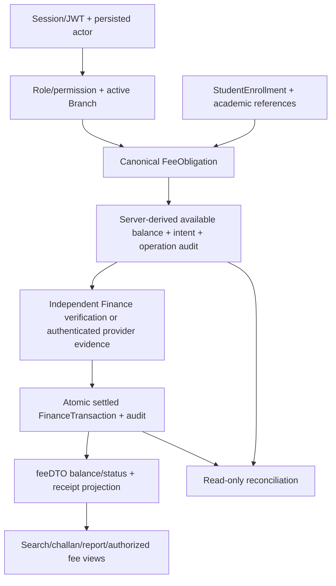

# Finance H-Series Audit

## 1. Baseline Git state

Branch `integration/team-merge`; HEAD `8e04401a93343cb06fc9558e4798a0d13b6fcccb`; clean worktree/index; H1–H6 committed; no merge in progress.

## 2. H1–H6 evidence map

| Slice | Commit | Canonical evidence |
| --- | --- | --- |
| H1 | cd9cf44a | finance-authority search/list/challan services; Finance routes/service/workspace; Finance security/client/UI tests |
| H2 | c65c9911 | financeCollectionReport; typed date/filter/report contract; Finance tests |
| H3 | 9de27a6f | reserve/recordManualPayment; intent DTO; Finance retry/session tests |
| H4 | c9a08410 | processProviderCallback; provider observations/adapter contract; provider tests; pr-h4-provider-verification.md |
| H5 | b8b76ae8 | verifyManualPayment; rollback/receipt scope/replay tests; pr-h5-settlement-receipt-closure.md |
| H6 | 8e04401a | financeReconciliation; existing route/pane; classification/zero-write tests; pr-h6-payment-reconciliation.md |

Read all three persistent H reports plus phase-e-finance.md. H1–H3 have commit/code/test evidence rather than separate persistent H reports. Existing reports are historical claims; implementation and tests are the audit authority.

## 3. H-series audit matrix

Completed before source modification. The initial Balance and Duplicate-authority rows were GAP; five regression cases reproduced the defects before the fix. Their final results below are PASS after the narrow fixes and full validation. No passing payment workflow was rewritten. Evidence abbreviations: A=`backend/src/services/finance-authority.service.ts`; P=`backend/src/services/finance-payment.service.ts`; M=`backend/src/models/finance.ts`; R=`backend/src/routes/finance.routes.ts`; FT/PT=`backend/tests/finance.security.test.ts` / `payment-provider.security.test.ts`.

| Area | Expected canonical behavior | Actual implementation evidence | Result | Required action |
| --- | --- | --- | --- | --- |
| Finance authentication | Active canonical Session/JWT actor | authenticateToken, isTokenRevoked, currentAcademicActor; FT session tests | PASS | Preserve |
| Finance permission enforcement | Server-side action grants | financeActor/financeWrite; FT missing view/record permission tests | PASS | Preserve |
| Branch scoping | Active server-derived Branch | financeActor, requireActiveAcademicBranch, scoped queries; FT/PT foreign tests | PASS | Preserve |
| Student placement authority | Enrollment for academic context | resolveStudentReadScope, activeEnrollmentFilter; FT invalid membership tests | PASS | Preserve |
| Dues/search | Canonical obligations only | A searchFinanceStudents/listFinanceFees; FT H1 tests | PASS | Preserve |
| Challan lookup | Exact scoped issued reference | A lookupFinanceChallan; FT unknown/foreign equivalence | PASS | Preserve |
| Collection report | Canonical read financial truth | A financeCollectionReport reuses feeDTO; FT dates/status/page tests | PASS | Preserve endpoint/semantics |
| Balance calculation | Safe integer entries and scoped consistent rollups | A feeDTO now validates each component and totals; FT five H-series audit regressions | PASS | GAP fixed: entry/currency validation and shared DTO rollup |
| Reservation | Safely hold available balance | P reserve; FT remaining balance/paid/competing key tests | PASS | Preserve |
| Idempotency | DB-backed replay | FinanceAudit operation index, fingerprints and fences; FT concurrency tests | PASS | Preserve |
| Provider verification | Authenticated exact evidence | P callback; PT signature/mapping/currency/config/outage tests | PASS | Preserve; real adapter remains disabled |
| Settlement | Atomic one-time effect | P callback/manual verify; PT/FT rollback and duplicate tests | PASS | Preserve |
| Receipt | Stable projection of settled transaction | M unique receipt/intent indexes; FT/PT replay and scope tests | PASS | Preserve |
| Reconciliation | Review only, sanitized, zero writes | P financeReconciliation; FT/PT H6 tests | PASS | Preserve |
| Parent fee visibility | Verified-child only | verifiedChild/readStudentFees; parent-scope tests and PT receipt tests | PASS | Preserve |
| Student fee visibility | Own authorized current context | resolveStudentSelf/readStudentFees; student-self tests | PASS | Preserve; no initiation |
| Finance audit trail | Transactional operation/effect evidence | M immutable fields; audit/financeWrite; rollback tests | PASS | Preserve |
| Concurrency | No overreservation/double settlement | Unique effect/operation indexes and Branch/fee fence; FT/PT concurrent tests | PASS | Preserve |
| Donor isolation | No donor runtime/auth/stores | app.ts route graph, import/store scans, canonical client | PASS | SAFE_ADAPTED |
| Duplicate authority | No independent financial truth | One ledger; summary now rolls up feeDTO rather than a divergent payment join | PASS | GAP fixed: preserve response metrics, remove inconsistent calculation |
| Dead/stale code | No alternate reachable live ledger | Legacy Fee limited to count/approval references; dev preview isolated | PASS | Document historical paths; do not delete |

## 4. Canonical Finance authority assessment

## 5. Money integrity assessment

Canonical meaning: balance = charge − settled effects; available = balance − held reservations. Held amounts are never paid. Safe integer minor units are authority; PKR labels and the legacy Principal rupee DTO are presentation conversions, not a separate stored balance.

Five pre-fix tests failed as expected: summary counted a different Student's effect; aggregate summary hid an overpaid obligation behind another unpaid charge; a foreign-currency payment was labeled PKR; positive settlements masked a negative settlement; positive holds masked a negative hold.

feeDTO now validates charge and every selected payment/hold as positive safe integer minor units within the existing per-entry bound and matching canonical currency before summation. Aggregate safe-integer/nonnegative/available checks remain. branchFinanceSummary now streams feeDTO results in a read-only snapshot, preserving legacy summary metrics while using the same Student-bound effects, currency and per-obligation validation as dues/collection reports. Total labels reject unsafe sums. No financial write/model or frontend financial calculation changed.

## 6. Reservation/idempotency assessment

PASS. Existing operation fingerprints and unique Branch/actor/operation audits provide persistent replay; conflicting reuse returns 409. Transactional Branch/obligation and actor/Session fences retain available-balance authority. Existing tests prove same-key concurrent replay creates one reservation/audit, competing keys cannot overreserve, settled obligations cannot be reserved and expired holds do not silently release funds. None of this implementation changed.

## 7. Provider verification assessment

Existing adapter authenticates before normalized event use; exact merchant/intent/transaction/amount/currency binding, strict shape, outage and replay guards preserved. Real-provider integration remains disabled and is not required by this audit.

## 8. Settlement/receipt assessment

PASS. Existing atomic verification/settlement and stable safe receipt projections preserved. Real replica-set tests inject transaction/audit failures and prove rollback; duplicate callbacks/manual verification retain one immutable effect and RC-intent receipt. Parent/Student/Finance read tests prove identity agreement, scope denial and zero-write reads. No new settlement flow, receipt store or endpoint.

## 9. Reconciliation assessment

H6 remains strictly read/review-only. Late captures retain holds; corruption is classified rather than repaired; no worker or recovery mutation exists.

## 10. RBAC and scope assessment

PASS. All `/api/finance/me` routes use canonical authentication plus Finance role middleware and Finance actor/action guards. View reads require finance.view; assignment requires fee management; manual recording requires payment record; independent verification/rejection requires payment verify. All use the active server-derived Branch, validated IDs/allowlists and object scope. Missing/revoked/inactive identity uses 401; authenticated forbidden actions use 403. Financial writes additionally fence and recheck authority before commit. Provider callback is intentionally provider-authenticated, not frontend Session-authenticated.

Finance/provider regressions prove wrong role, missing permission, inactive/revoked actor, foreign Branch/Student/obligation, guessed IDs and no client scope override. Principal authorization/enrollment consumers were also rerun because the fixed summary is shared. Frontend visibility remains presentation only.

## 11. Parent/Student boundary assessment

Verified child/own current membership reads reuse readStudentFees. Neither role receives Finance write permissions. Parent provider checkout remains gated; Student initiation is absent.

## 12. Donor contamination assessment

Canonical import/store scans found adapted UX/algorithms only (SAFE_ADAPTED), no donor auth/runtime/ledger, parentOnlinePayments/parentBatchPayments/invoiceReservations stores, merchant worker import or hardcoded live provider assumptions. FinancePreview acknowledges donor visual inspiration but is guarded by __DEV__ in the navigator and preview itself. No CONFLICTING or BLOCKER donor authority found; no donor work imported. Historical Fee is reference-only/DUPLICATE_DEAD as a live balance/settlement path, not deleted.

## 13. Dead/legacy code assessment

models/fee.ts retains historical records referenced by approval-scope.service.ts and legacy-unmigrated counts, not live settlement. fee.service.ts is a compatibility reader over canonical summary. FinancePreview is development-only sample UI, not a live provider/store. No deletion justified. Phase-E historical report predates H1–H6 and its old pagination/coverage statements are superseded by the H reports and this audit.

## 14. API consistency assessment

PASS after fixes. Existing errors distinguish invalid input 400, session 401, permission/scope 403, unknown/foreign challan 404, conflict 409 and ledger/provider-unavailable 503. H1/H2 use canonical status strings; H6 classification is a separate review vocabulary. Receipt projections share the same settled identity. Amounts are integer minor units with server labels; the Principal compatibility reader alone converts to rupees for its established read DTO.

Collection dates mean inclusive obligation due-date cohorts with all settled effects, not settlement-date cashflow. Its full filtered summary is independent of detail paging. Principal summary partial/overdue invoice metrics intentionally retain their legacy numerical definitions (partial includes partially collected held invoices; overdue includes any past-due outstanding invoice), while collection statusCounts use canonical feeDTO precedence. This is documented metric semantics, not different money authority.

H1/H2/H6 limits and offsets are validated. H6 pages payment candidates before classification; empty filtered pages may have nextOffset. Its latest-100 observation view is separate. Student/Parent histories over 100 obligations fail explicitly rather than silently truncating. These existing contracts remain unchanged.

## 15. Test quality assessment

Existing tests exercise real replica-set transactions, database uniqueness, concurrent requests, injected rollback, verified-child scope, stale UI generations, financial read snapshots and receipt stability. Five new audit cases reproduce the proven consistency/integrity gaps; all five failed before source changes and pass after them. Two existing native-import test fixtures now supply the currency already required by the canonical intent model; no existing assertion was removed or weakened.

## 16. Fixes made

Two narrow source fixes, both in `backend/src/services/finance-authority.service.ts`:

1. feeDTO validates individual payment/hold entries before summing, rejecting mixed currency, negative or unsafe components even when totals appear valid.
2. branchFinanceSummary uses a snapshot rollup of feeDTO, removing the inconsistent Student join and per-obligation corruption masking while retaining established summary fields/count semantics.

`backend/tests/finance.security.test.ts` adds five audit regressions and corrects two required-currency fixture omissions. This report is the only new file. Models, routes, frontend, reservation/idempotency, provider verification, settlement, receipt and reconciliation workflows are unchanged.

## 17. Validation results

| Check | Result |
| --- | --- |
| Finance backend/security tests | 65 PASS, 0 FAIL |
| Provider security tests | 33 PASS, 0 FAIL |
| Student/Parent backend regressions | 43 PASS, 0 FAIL |
| Principal authorization/enrollment consumers | 108 PASS, 0 FAIL |
| Backend total | 249 PASS, 0 FAIL; seven files |
| Finance frontend | 61 PASS, 0 FAIL |
| Student frontend service/workspace | 19 PASS, 0 FAIL |
| Parent frontend service/workspace | 24 PASS, 0 FAIL |
| Auth/session and Developer Preview | 14 PASS, 0 FAIL |
| Frontend total | 118 PASS, 0 FAIL; eight suites |
| Backend source TypeScript | PASS |
| Mobile source/test TypeScript | PASS |
| Root TypeScript against starting HEAD | 76 baseline; 76 final; 0 introduced |
| Scoped ESLint | Two changed TS files; 0 errors/warnings |
| git diff --check | PASS |

Validation evidence: existing ignored `.validation-principal-audit/h-series-audit/`. Five pre-fix failures are reproduction evidence, not final failures. No dependency/native/asset change; Android build unnecessary.

## 18. Remaining non-blocking issues

No remaining H-series safety blocker found. Review/commit this audit's fixes before treating closure as the committed baseline. Real-provider activation, export/printing, reconciliation recovery and trusted legacy migration remain deferred and are not prerequisites for this scoped manual-payment/read-review closure. Real-provider adapter implementation was explicitly excluded from the audit. Broader accounting, payroll, expenses and AI are not claimed complete.

The snapshot summary reuses feeDTO per obligation (bounded cursor memory, additional read queries); no performance benchmark was part of this audit. Existing pagination/statement limits remain product constraints. Phase-E historical reports remain historical evidence rather than current capability inventories. No Phase F work was started.

## 19. Persistent report

Created docs/integration/finance-h-series-audit.md before source changes to record the audit matrix.

## 20. Final Git state

- Branch `integration/team-merge`; HEAD unchanged at `8e04401a93343cb06fc9558e4798a0d13b6fcccb`.
- Zero staged files; two modified tracked files and this new untracked report, all unstaged.
- No unrelated initial changes; no merge in progress.
- No staging, commit, push, merge, cherry-pick, reset, clean or branch switch performed. Phase F has not started.

## 21. Finance H-Series Audit Verdict

PASS WITH ACTIONS

PHASE F READY: YES

Finance Phase E can close for the approved H1–H6 scope after review/commit of the included fixes. This recommendation does not enable the disabled live-provider adapter or deferred recovery/accounting workflows.
